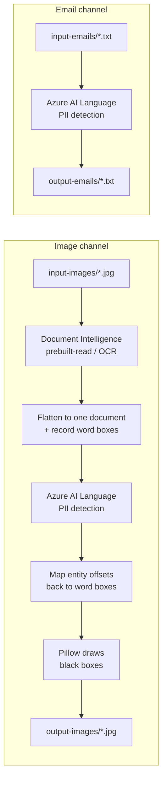

# PII Redaction Demo

> ## This is a proof of concept. It is not production code.
>
> The **only** purpose of this repository is to demonstrate the **end-to-end flow** of PII
> redaction across Azure AI services — image in, OCR, PII detection, masked output — and to make
> every intermediate step visible so you can see what each service contributes.
>
> **There is no error handling.** No retries, no input validation, no fault isolation, no
> telemetry. Failures surface as raw unhandled exceptions, deliberately, so the cause is obvious
> during a walkthrough.
>
> **Do not run this against real customer data.** Read [Limitations](#limitations) first.
>
> ---
>
> **Personal project disclaimer.** This is independent personal work by Vinod Patil, created
> outside the scope of any employment. It is **not a Microsoft product** and is not affiliated
> with, endorsed by, sponsored by, or supported by Microsoft Corporation. All design choices and
> opinions here are the author's own and do not represent those of any employer. The code is
> provided as-is under the [MIT License](LICENSE), with no warranty and no support commitment.

---

## What it demonstrates

Two channels: Document Intelligence Read extracts image text, and Azure AI Language detects PII.
The services use separate Azure accounts and endpoints with shared Entra ID authentication.



The interesting part is the image channel. Azure AI Language returns character offsets into a text
document; an image has no character offsets. The pipeline flattens OCR output into a single
document while recording where each recognized word landed, then maps the detected entity spans
back onto the original word polygons so the right pixels get masked.

Emails skip OCR entirely and go straight to PII detection.

OCR uses the **GA Document Intelligence v4.0 API (`2024-11-30`)** and the `prebuilt-read` model.
The provider submits an analysis job and waits for completion using the SDK poller, then maps
page-level words to lines using their text spans. Word polygons are converted to image pixel
coordinates for the existing masking pipeline. No custom model training is needed.

**Reference-only legacy provider:**
[src/pii_redaction_demo/providers/azure_vision.py](src/pii_redaction_demo/providers/azure_vision.py)
is retained only for comparison with the previous Azure Vision Image Analysis OCR implementation.
The application does not import or use it; **Document Intelligence is the only active OCR provider**.
Its `azure-ai-vision-imageanalysis` SDK is not installed by this project's dependencies, and the
reference module is excluded from active-code type checking and coverage measurement.

References: [Read model](https://learn.microsoft.com/en-us/azure/ai-services/document-intelligence/prebuilt/read?view=doc-intel-4.0.0)
and [Image Analysis migration guidance](https://learn.microsoft.com/en-us/azure/ai-services/computer-vision/migration-options).

---

## Quick start

### Prerequisites

- Python 3.11 or later
- Azure CLI, signed in (`az login`)
- Terraform 1.7 or later
- An Azure subscription where you can create resource groups **and role assignments**

### 1. Install

```powershell
python -m venv .venv
.\.venv\Scripts\Activate.ps1
python -m pip install -e ".[dev]"
```

### 2. Deploy the Azure resources

```powershell
cd infra/terraform/environments/dev
Copy-Item terraform.tfvars.example terraform.tfvars
# Edit terraform.tfvars and set subscription_id to your own subscription.
terraform init
terraform plan -out=tfplan
terraform apply tfplan
```

This creates a multi-service Azure AI Services account for Language and a Foundry project,
plus a dedicated Document Intelligence account for OCR. See [Infrastructure](#infrastructure).

> Role assignments on the Cognitive Services data plane can take up to ~15 minutes to propagate.
> A `401 PermissionDenied` immediately after `apply` is expected — wait and retry before
> investigating.

### 3. Configure the app

```powershell
cd ../../../..
Copy-Item .env.example .env
terraform -chdir=infra/terraform/environments/dev output -raw ai_services_endpoint
terraform -chdir=infra/terraform/environments/dev output -raw document_intelligence_endpoint
```

Put the first endpoint into `.env` as `APP_AI_SERVICES_ENDPOINT` and the second as
`APP_DOCUMENT_INTELLIGENCE_ENDPOINT`. Email-only mode needs only the Language endpoint.

**Upgrading an existing deployment:** keep your current `terraform.tfvars` and `.env`; do not
overwrite them with the examples. Run `terraform init`, review a new plan, and apply it to add
the Document Intelligence account and its role assignments. The existing AI Services account and
Foundry project remain in place. Add the new OCR endpoint to `.env`, and reinstall with
`python -m pip install -e ".[dev]"`. The old Image Analysis endpoint is no longer used by the app.

### 4. Run it

```powershell
# Both channels, with the step-by-step trace report
python -m pii_redaction_demo.main --mode all --trace

# One channel at a time
python -m pii_redaction_demo.main --mode images
python -m pii_redaction_demo.main --mode emails
```

Sample inputs ship in `input-images/` and `input-emails/`. Redacted copies are written to
`output-images/` and `output-emails/` under the original file names.

```text
INFO    pii_redaction_demo.services.pipeline: redacting 5 image(s) from ...\input-images
INFO    pii_redaction_demo.services.pipeline: chat-01-fraud-dispute.jpg: 84 word(s) read, 6 entity(ies), 9 box(es) -> ...
INFO    pii_redaction_demo.main: done: 5 image(s), 5 email(s), 41 PII entity(ies) masked
```

### 5. Open the trace report

`--trace` is the part worth demoing. It writes `data/processed/<timestamp>/` containing the
output of every step — source, normalized OCR JSON with word boxes, the flattened document, the detected
entities, and the masked result — plus a `report.html` showing them side by side with the OCR and
PII boxes drawn on the image. Open that file to walk through what each service contributed.

> **The trace directory is an unredacted plaintext PII store.** It holds original text, detected
> entity values, and source images by design, so a reviewer can validate the pipeline. It is
> gitignored. Delete it when you are done.

---

## Command line reference

| Flag | Purpose |
| --- | --- |
| `--mode {images,emails,all}` | Which channel to process. Default `all`. |
| `--trace` | Write per-step artifacts and a side-by-side `report.html`. |
| `--trace-dir` | Where the trace run lands. Default `data/processed`. |
| `--verbose` | Log at `DEBUG` instead of `APP_LOG_LEVEL`. |
| `--input-dir` / `--output-dir` | Override the image directories. |
| `--email-input-dir` / `--email-output-dir` | Override the email directories. |

## Configuration

Settings are read from `.env` with the `APP_` prefix. See `.env.example`.

| Setting | Default | Purpose |
| --- | --- | --- |
| `APP_AI_SERVICES_ENDPOINT` | *(required)* | Azure AI Services account endpoint for Language PII |
| `APP_DOCUMENT_INTELLIGENCE_ENDPOINT` | *(required for images/all)* | Dedicated Document Intelligence account endpoint for Read OCR |
| `APP_PII_LANGUAGE` | `en` | Language hint passed to Azure AI Language |
| `APP_PII_MIN_CONFIDENCE` | `0.0` | Drop detections below this confidence before masking |
| `APP_LOG_LEVEL` | `INFO` | Root log level |
| `APP_INPUT_IMAGES_DIR` / `APP_OUTPUT_IMAGES_DIR` | `input-images` / `output-images` | Image directories |
| `APP_INPUT_EMAILS_DIR` / `APP_OUTPUT_EMAILS_DIR` | `input-emails` / `output-emails` | Email directories |
| `APP_TRACE_DIR` | `data/processed` | Trace output root |

`APP_PII_MIN_CONFIDENCE=0.0` masks everything Azure AI Language returns, which is the safest
default. Raise it to around `0.8` to see the effect of trading recall for precision.

Authentication uses `DefaultAzureCredential` — no keys anywhere. `az login` is enough locally.

---

## Sample data

> **All sample data in this repository is synthetic. It describes no real person, account, card,
> or organization.**

The emails in `input-emails/` and the chat screenshots in `input-images/` were fabricated for this
demo. They use reserved test ranges wherever one exists:

| Field | Convention |
| --- | --- |
| Names | Locale placeholder names (John Q. Public, Jane A. Bloggs, Taro Yamada, Fulan Al-Fulani) |
| SSNs | The SSA advertising-reserved block `987-65-432x` |
| Addresses | `Example`-named streets |
| Phone numbers | Reserved `555-01xx` and `+44 7700 900xxx` ranges |
| Card numbers | Standard issuer test PANs |
| Email domains | `.test` and `example-*` domains |
| Organizations | Invented brands (Bluecrest Card Services, Fictional Logistics FZE) |

> **Known gap:** the JPEGs in `input-images/` are raster files, so a few pre-existing synthetic
> values are baked into the pixels and were not updated to the ranges above. Notably
> `chat-05-hardship-name-change.jpg` contains a Luhn-valid card number and a valid-format SSN.
> Both are fabricated, but automated DLP scanners may flag them. Regenerate the images if that
> matters in your environment.

---

## Limitations

These are deliberate simplifications, not oversights. Every one must be addressed before this
approach goes near real data.

### 1. There is no error handling

The single largest gap. Failures propagate as unhandled exceptions and the process dies. Missing
entirely:

- **Retries.** No backoff for throttling (HTTP 429) or transient 5xx errors. The Azure SDK
  defaults are not tuned for batch workloads.
- **Input validation.** Unsupported formats, empty or corrupt files, oversized images, and
  unreadable encodings all fail late and unhelpfully.
- **Exit codes and run summaries.** Nothing can orchestrate or monitor this process.
- **Client lifecycle management.** The Azure clients expose `close()` and nothing calls it.
- **Structured logging and telemetry.** The app prints to stdout and never uses the configured
  log level. Correlation IDs per item do not exist.

### 2. Document size limits are not enforced

Azure AI Language caps a single document at ~5,120 characters and a request at ~125,000
characters. `PiiRedactionService` batches by document *count* only (5 per request), so a long
email or a text-heavy image is rejected by the service. Production code must split documents into
service-safe chunks and reassemble the results, remapping entity offsets back to the original.

The image channel accepts single-page JPEG, PNG, BMP, and TIFF images; it does not add PDF or
Office-document redaction even though Document Intelligence supports those inputs. Multi-page
OCR results and non-pixel coordinates are rejected to avoid masking the wrong page or location.
Document Intelligence image limits (including 50 x 50 through 10,000 x 10,000 pixels) still apply.
The app does not prevalidate file sizes or dimensions. OCR is a submit-and-poll operation, not a
single synchronous HTTP response; benchmark latency and mask alignment on your own synthetic
inputs before relying on it. The application does not set an overall OCR polling deadline.

### 3. There is no per-item fault isolation

Each pipeline processes a directory as a single batch. One bad input aborts the entire run and no
results are written at all. Production code should isolate each file, record failures alongside
successes, and return a per-item status.

### 4. Trace output contains unredacted PII

`--trace` writes original text, detected entity values, source images, and an HTML report into
`data/processed/`. This is intentional so a reviewer can validate the pipeline, but it is a
plaintext PII store. Production code should default to redacted-only artifacts; any full-fidelity
mode needs encryption at rest, access control, retention limits, and audit logging.

### 5. A detection miss is a data leak, not a degraded result

The pipeline treats whatever Azure AI Language returns as complete. It is not. There is no
confidence floor by default, no deterministic backstop, and no quarantine path. Production needs a
defined failure policy — decide up front whether a partially-processed item is withheld rather
than published — plus defense in depth such as regex checks for card numbers alongside the model
output.

### 6. Infrastructure is demo-grade

Terraform state is local, not remote. There is no private networking, no customer-managed keys, no
diagnostic settings, and no lifecycle policy. `dev` is the only environment.

---

## Infrastructure

The `dev` environment provisions a resource group containing two service accounts and one
Foundry project:

| Resource | Kind | Purpose |
| --- | --- | --- |
| `cog-<prefix>-aiservices-<suffix>` | `AIServices` | Language PII detection and Foundry resource |
| `cog-<prefix>-docintel-<suffix>` | `FormRecognizer` | Document Intelligence `prebuilt-read` OCR |
| `<account>/<project>` | `AIServices` project | Foundry portal playgrounds, evaluations, traces |

`project_management_enabled = true` is what turns the account into a Foundry resource: it makes
the account visible in the Foundry portal and lets it parent `accounts/projects` children. The
flag provisions nothing on its own, so the project is declared explicitly.

The service accounts and project expose different endpoints:

| Endpoint | Terraform output | Serves |
| --- | --- | --- |
| `https://<ai-account>.cognitiveservices.azure.com/` | `ai_services_endpoint` | Language PII detection |
| `https://<docintel-account>.cognitiveservices.azure.com/` | `document_intelligence_endpoint` | Document Intelligence Read OCR |
| `https://<account>.services.ai.azure.com/api/projects/<project>` | `ai_project_endpoint` | Agents, evaluations, datasets, files |

The app uses the two account endpoints, not the project endpoint. The dedicated Document
Intelligence resource has a custom subdomain for Entra ID authentication. Its SKU defaults to
`S0`; set `document_intelligence_sku_name = "F0"` for a free-tier trial where available. OCR is
billed separately from Language PII.

> Data-plane role assignments are scoped to each service account. A role on the Foundry project
> alone does not grant OCR or Language PII access.

See [docs/architecture.md](docs/architecture.md) for the overall flow.

### Authentication

Both accounts default to `local_auth_enabled = false`, disabling API-key authentication; every
application call uses an Entra ID token. Terraform grants `Cognitive Services User` on both
accounts to each configured caller, plus `Foundry User` on the AI Services account for portal access.

**Data-plane access needs an explicit role.** Subscription Owner or Contributor does **not** grant
it. Grant additional callers via `data_plane_principal_ids`, and set `data_plane_principal_type` to
`ServicePrincipal` for managed identities or app registrations:

```hcl
data_plane_principal_ids  = ["00000000-0000-0000-0000-000000000000"]
data_plane_principal_type = "ServicePrincipal"
```

### Verify

`smoke-test.ps1` reads both endpoints from Terraform outputs, calls both data planes with an Entra
ID token, and confirms the Foundry project exists. The Read check submits a public sample image
and polls for up to two minutes. Any failed check causes the script to fail:

```powershell
./smoke-test.ps1
```

```text
LANGUAGE PII: OK
  redacted: ********'s card number is ******************* and her email is ********************.
  entities: Person, CreditCardNumber, Email
DOCUMENT INTELLIGENCE READ: OK
  lines read: 16
FOUNDRY PROJECT: OK
  <project> (default: True)
```

The OCR provider and smoke test both target `api-version=2024-11-30` with `prebuilt-read`.
For an OCR authorization failure, check the Document Intelligence endpoint and role assignment
on that account, not just the role assignment on the Language account.

### Tear down

From the repository root, review and apply a destroy plan for **dev only**:

```powershell
terraform -chdir=infra/terraform/environments/dev plan -destroy -out=tfplan
terraform -chdir=infra/terraform/environments/dev apply tfplan
Remove-Item infra/terraform/environments/dev/tfplan
```

Cognitive Services accounts are soft-deleted. The provider sets
`purge_soft_delete_on_destroy = true` so the name is released; otherwise redeploying with the same
name fails until the soft-deleted account is purged.

This deletes the deployed resources and their cloud-side data, not the local demo inputs,
outputs, or reports. Keep the Terraform configuration, `.terraform.lock.hcl`, your local
`terraform.tfvars`, and the updated local state. Keep state and variable files private and
out of Git. Do not restore pre-destroy state after a successful teardown or reuse old plans.

### Recreate for a future demo

From the repository root, reuse your existing `terraform.tfvars` (do not overwrite it with
the example):

```powershell
az login
terraform -chdir=infra/terraform/environments/dev init
terraform -chdir=infra/terraform/environments/dev validate
terraform -chdir=infra/terraform/environments/dev plan -out=tfplan
terraform -chdir=infra/terraform/environments/dev apply tfplan
Remove-Item infra/terraform/environments/dev/tfplan
terraform -chdir=infra/terraform/environments/dev output -raw ai_services_endpoint
terraform -chdir=infra/terraform/environments/dev output -raw document_intelligence_endpoint
```

Check `subscription_id`, region, and any explicit principal IDs in `terraform.tfvars` before
planning. With the default empty principal list, access is granted to the deploying identity.
The random suffix is recreated after destruction, so both account names and endpoints will change.
Update `APP_AI_SERVICES_ENDPOINT` and `APP_DOCUMENT_INTELLIGENCE_ENDPOINT` in your existing `.env`
with the corresponding outputs. Allow up to
~15 minutes for role assignments to propagate, then verify and run the demo:

```powershell
Push-Location infra/terraform/environments/dev
try { ./smoke-test.ps1 } finally { Pop-Location }
python -m pii_redaction_demo.main --mode all --trace
```

---

## Repository layout

```text
src/pii_redaction_demo/
  core/              Configuration (pydantic-settings)
  domain/            Business entities
  providers/         Azure and imaging adapters, plus the protocols they implement
  services/          Pipelines and trace reporting
tests/unit/          Fast, isolated tests
tests/integration/   Boundary and adapter tests (empty)
tests/e2e/           Deployed-system tests (empty)
infra/terraform/     Reusable modules and environment roots
input-emails/        Synthetic sample emails
input-images/        Synthetic sample chat screenshots
data/processed/      Local-only trace output (gitignored)
docs/                Architecture and Foundry reference notes
```

Adapters sit behind protocols in `providers/protocols.py`, so the Azure clients can be swapped for
fakes in tests without touching pipeline logic.

## Development

```powershell
pytest --cov
ruff check .
ruff format --check .
mypy
```

CI runs the same four commands on every push and pull request.

Never commit secrets, customer data, credentials, or Terraform state. The `.gitignore` files
exclude `.env`, `*.tfstate*`, `*.tfvars`, `tfplan`, trace output, and local caches — check
`git status` before your first commit.

## License

MIT. See [LICENSE](LICENSE).
