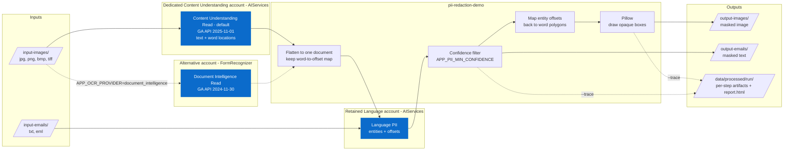
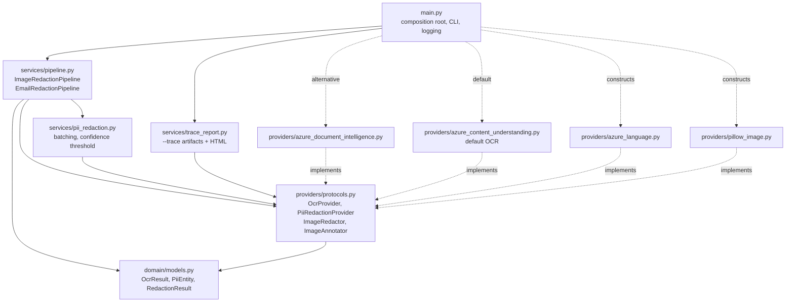

# Architecture

## What this does

Two input channels — chat/screenshot images and plain-text emails — are reduced to text, scanned
for PII by Azure AI Language, and masked. Images are masked visually (opaque boxes over the
pixels where the PII was read); emails are masked in the text itself.



The image path is the interesting one. Azure AI Language works on text and returns character
offsets, but masking an image needs pixel coordinates. The pipeline bridges the two by recording
where every OCR word landed in the flattened document, then translating each PII entity's offset
range back to the polygons of the words it overlaps.

The default OCR adapter calls Content Understanding `prebuilt-read` with pinned GA API version
`2025-11-01` through `ContentUnderstandingClient.begin_analyze_binary`. The Python SDK requests
`codePoint` spans. The adapter waits for the poller, groups page-level words into lines by span
containment, sorts by offsets, and decodes `D(page,...)` source locations (quadrilaterals or
axis-aligned boxes) into integer pixel pairs. The pipeline rebuilds plain text from recognized
lines rather than using generated summaries or Markdown formatting for PII offsets.

The retained `AzureDocumentIntelligenceOcrProvider` uses `prebuilt-read` and GA API `2024-11-30`.
Set `APP_OCR_PROVIDER=document_intelligence` to select it; the default is
`content_understanding`. Each provider requires its own configured endpoint. There is no
automatic fallback between services.

Both produce the same `OcrResult`; Language PII, offset mapping, Pillow masking, and trace
reporting remain provider-independent. `model_version` is left unset because neither adapter
maps its service's API version to the legacy Vision model-version field. Trace OCR JSON is the
normalized domain result, not a verbatim service response.

This remains a single-page image pipeline. Multiple pages and non-pixel coordinate units are
rejected, rather than combining polygons from different pages or treating inches as pixels.
The Content Understanding adapter also rejects invalid/missing source locations, missing spans,
and unmapped words so they cannot silently disappear from the redaction map.
PDF and Office-document redaction are not added by this migration.

## Why this default for new workloads

For new **cloud OCR/layout workloads like this image-redaction use case**, Microsoft's
[selection guide](https://learn.microsoft.com/azure/ai-services/content-understanding/choosing-right-ai-tool#quick-reference-decision-guide)
recommends Content Understanding `prebuilt-read`/`prebuilt-layout`, citing lower cost and richer
layout extraction. The recommendation covers GA API `2025-11-01`; this app does not require a
preview API. Start with Read because masking needs text and coordinates, not table structure.
The [pricing guide](https://learn.microsoft.com/azure/ai-services/content-understanding/pricing-explainer#frequently-asked-questions)
confirms extraction-only analyzers have no LLM charges. No LLM/embedding deployments or model
defaults are provisioned for this app.

Document Intelligence remains available and appropriate for existing applications and specialized
structured-form extraction. This is not a blanket recommendation to replace it in every new
document-processing workload. Neither service guarantees complete PII detection: benchmark
recall, over-redaction, Unicode offset alignment, pixel coverage, latency, and cost on representative
inputs before production. Native-document PII redaction, including embedded-image coverage,
requires a separate design and validation. Sources checked November 11, 2026.

```mermaid
sequenceDiagram
    participant CLI as main.py
    participant P as ImageRedactionPipeline
    participant O as AzureContentUnderstandingOcrProvider
    participant D as Content Understanding Read
    participant L as Azure AI Language
    participant I as PillowImageRedactor

    CLI->>P: run(input_dir, output_dir)
    loop each image
        P->>O: read_image(bytes)
        O->>D: begin_analyze_binary(prebuilt-read, bytes)
        D-->>O: operation location
        loop SDK poller until completed or failed
            O->>D: get analysis result
            D-->>O: status / AnalysisResult
        end
        O->>O: map words to lines; decode sources; validate pixels
        O-->>P: OcrResult (lines + words + polygons)
        P->>P: _flatten() to document + WordSpan[]
        P->>L: recognize_pii_entities(document)
        L-->>P: entities (offset, length, score)
        P->>P: drop entities below min_confidence
        P->>P: _polygons_for_entities() to overlapping word boxes
        P->>I: mask(bytes, polygons)
        I-->>P: masked image
    end
    P-->>CLI: RedactedImage[]
```

## Code layout

Dependencies point inward. `services/` depends only on the protocols in
`providers/protocols.py`; the Azure and Pillow adapters implement them structurally and are wired
together in `main.py`. Domain objects stay free of SDK types, so the pipelines are testable with
plain stubs and no mocking framework.



## Authentication

Content Understanding and Language use separate accounts. The alternative Document Intelligence
provider also retains its dedicated account. All three accounts have `local_auth_enabled = false`,
disabling API-key authentication. `main.py`
creates one `DefaultAzureCredential` and passes it to the selected OCR and Language adapters.
Callers need `Cognitive Services User` on the account(s) they use; subscription Owner or
Contributor does not grant data-plane access. All accounts use custom subdomains for Entra ID.

| Configuration | Resource | Use |
| --- | --- | --- |
| `APP_AI_SERVICES_ENDPOINT` | Existing `AIServices` account | Language PII in both channels |
| `APP_CONTENT_UNDERSTANDING_ENDPOINT` | Dedicated AIServices resource, `https://<content-account>.services.ai.azure.com/` | Default Read OCR in images/all modes |
| `APP_DOCUMENT_INTELLIGENCE_ENDPOINT` | Dedicated `FormRecognizer` account | Alternative Read OCR when selected |

Terraform preserves the Language and Document Intelligence accounts, their role assignments, and
the existing Foundry project. It adds a dedicated S0 AIServices account for Content Understanding,
including a system-assigned managed identity, custom subdomain, and caller RBAC. No additional
project or model deployment is needed for Read. The endpoint output targets Azure public cloud.
The separate account isolates OCR permissions, quota, and accounting even though the existing
Language account can also support Content Understanding.
The configured region must [support Content Understanding](https://learn.microsoft.com/azure/ai-services/content-understanding/language-region-support).
The Foundry project is for playgrounds, evaluations, and traces; neither application data-plane
call uses its project endpoint. Email-only runs require neither OCR endpoint.

## Conventions

Model-specific clients belong in `providers/`; do not call an Azure SDK from `services/` or
`domain/`. Keep evaluation datasets free of sensitive customer data and add automated quality
gates beside conventional tests.

Infrastructure is organized as reusable Terraform modules plus isolated environment roots.
Remote state, provider configuration, resource naming, and policy controls should be selected
when the deployment cloud and environments are known.

See the [Limitations](../README.md#limitations) section of the README for the gaps that must be closed before this
design is used against real data.
