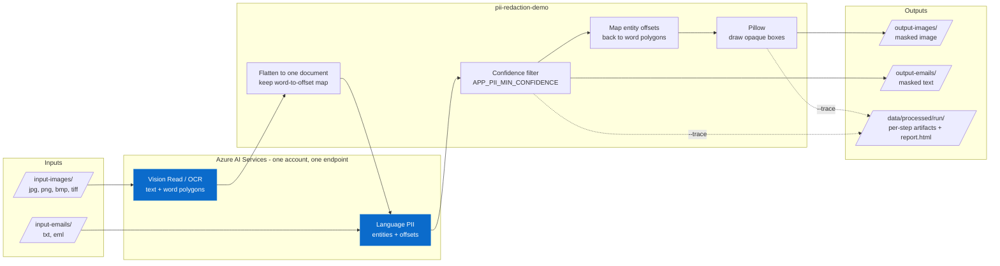
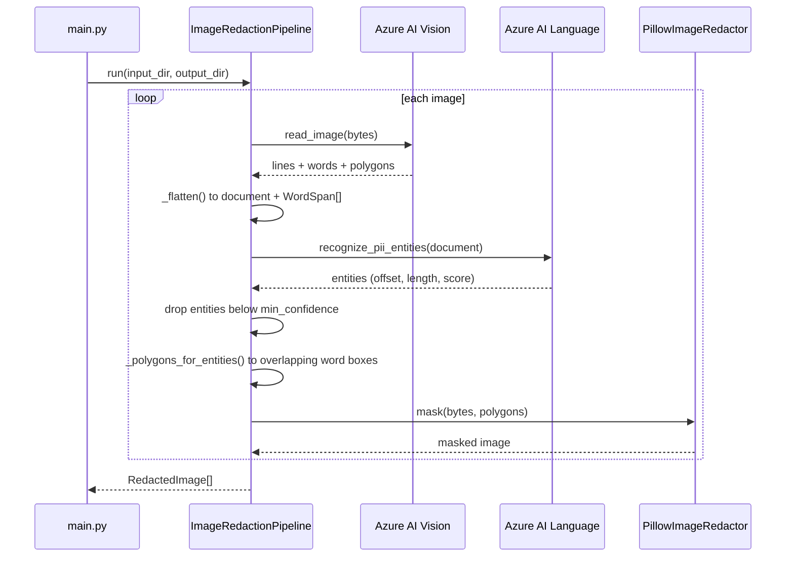
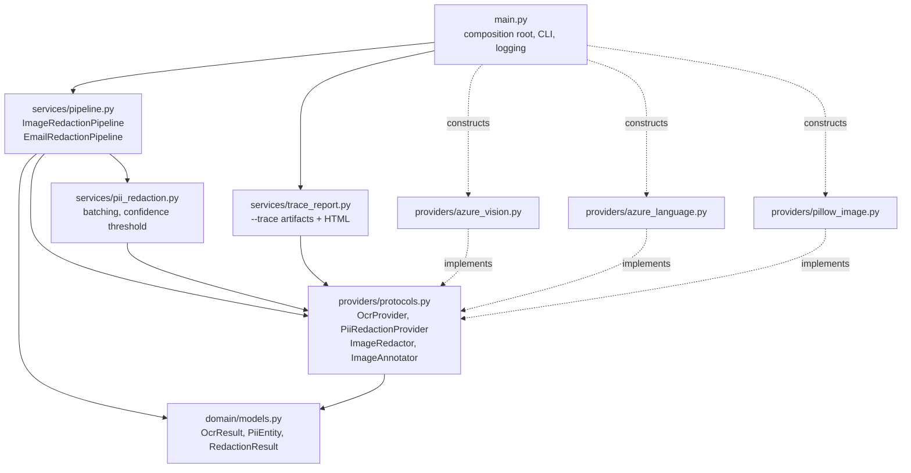

# Architecture

## What this does

Two input channels — chat/screenshot images and plain-text emails — are reduced to text, scanned
for PII by Azure AI Language, and masked. Images are masked visually (opaque boxes over the
pixels where the PII was read); emails are masked in the text itself.

The image path is the interesting one. Azure AI Language works on text and returns character
offsets, but masking an image needs pixel coordinates. The pipeline bridges the two by recording
where every OCR word landed in the flattened document, then translating each PII entity's offset
range back to the polygons of the words it overlaps.

## Code layout

Dependencies point inward. `services/` depends only on the protocols in
`providers/protocols.py`; the Azure and Pillow adapters implement them structurally and are wired
together in `main.py`. Domain objects stay free of SDK types, so the pipelines are testable with
plain stubs and no mocking framework.

## Authentication

Both data planes sit behind one Azure AI Services account with `local_auth_enabled = false`, so
API keys do not exist. `main.py` creates a single `DefaultAzureCredential` and passes it to both
adapters, which keeps token acquisition and caching in one place. Callers need an explicit
`Cognitive Services User` role assignment on the account — subscription Owner or Contributor does
not grant data-plane access.

## Conventions

Model-specific clients belong in `providers/`; do not call an Azure SDK from `services/` or
`domain/`. Keep evaluation datasets free of sensitive customer data and add automated quality
gates beside conventional tests.

Infrastructure is organized as reusable Terraform modules plus isolated environment roots.
Remote state, provider configuration, resource naming, and policy controls should be selected
when the deployment cloud and environments are known.

See the "Scope: this is a POC" section of the README for the gaps that must be closed before this
design is used against real data.
