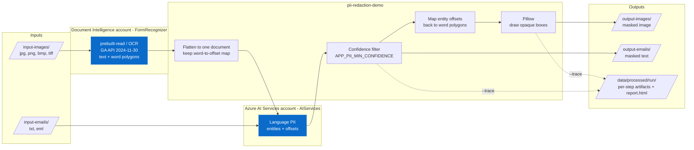
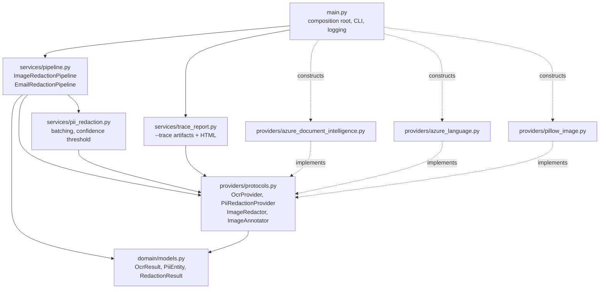

# Architecture

## What this does

Two input channels — chat/screenshot images and plain-text emails — are reduced to text, scanned
for PII by Azure AI Language, and masked. Images are masked visually (opaque boxes over the
pixels where the PII was read); emails are masked in the text itself.



The image path is the interesting one. Azure AI Language works on text and returns character
offsets, but masking an image needs pixel coordinates. The pipeline bridges the two by recording
where every OCR word landed in the flattened document, then translating each PII entity's offset
range back to the polygons of the words it overlaps.

The OCR adapter calls Document Intelligence `prebuilt-read` with the pinned GA API version
`2024-11-30`. It waits for the SDK poller, groups page-level words into lines by span containment,
sorts words by their offsets, and converts the flat polygon coordinates into integer pixel pairs.
The resulting `OcrResult` preserves the existing pipeline contract; the Language PII and Pillow
masking implementations are unchanged. `model_version` is left unset because the Read response
exposes an API version and model ID, not the Vision model-version field. Trace OCR JSON is the
normalized domain result, not a verbatim Document Intelligence response.

This remains a single-page image pipeline. Multiple pages and non-pixel coordinate units are
rejected, rather than combining polygons from different pages or treating inches as pixels.
PDF and Office-document redaction are not added by this migration.

```mermaid
sequenceDiagram
    participant CLI as main.py
    participant P as ImageRedactionPipeline
    participant O as AzureDocumentIntelligenceOcrProvider
    participant D as Document Intelligence Read
    participant L as Azure AI Language
    participant I as PillowImageRedactor

    CLI->>P: run(input_dir, output_dir)
    loop each image
        P->>O: read_image(bytes)
        O->>D: begin_analyze_document(prebuilt-read, bytes)
        D-->>O: operation location
        loop SDK poller until completed or failed
            O->>D: get analysis result
            D-->>O: status / AnalyzeResult
        end
        O->>O: map words to lines by spans; validate pixel units
        O-->>P: OcrResult (lines + words + polygons)
        P->>P: _flatten() to document + WordSpan[]
        P->>L: recognize_pii_entities(document)
        L-->>P: entities (offset, length, score)
        P->>P: drop entities below min_confidence
        P->>P: _polygons_for_entities() to overlapping word boxes
        P->>I: mask(bytes, polygons)
        I-->>P: masked image
    end
    P-->>CLI: RedactedImage[]
```

## Code layout

Dependencies point inward. `services/` depends only on the protocols in
`providers/protocols.py`; the Azure and Pillow adapters implement them structurally and are wired
together in `main.py`. Domain objects stay free of SDK types, so the pipelines are testable with
plain stubs and no mocking framework.



## Authentication

The data planes use separate accounts with `local_auth_enabled = false`, disabling API-key
authentication. `main.py` creates a single `DefaultAzureCredential` and passes it to both adapters,
which keeps token acquisition and caching in one place. Callers need an explicit
`Cognitive Services User` role assignment on **each account**; subscription Owner or Contributor
does not grant data-plane access. Both accounts use custom subdomains for Entra ID authentication.

| Configuration | Resource | Use |
| --- | --- | --- |
| `APP_AI_SERVICES_ENDPOINT` | Existing `AIServices` account | Language PII in both channels |
| `APP_DOCUMENT_INTELLIGENCE_ENDPOINT` | Dedicated `FormRecognizer` account | Read OCR in images/all modes |

Terraform preserves the AI Services account and its Foundry project and adds the Document
Intelligence account and its role assignments. The Foundry project is for playgrounds,
evaluations, and traces; neither application data-plane call uses the project endpoint.
Email-only runs do not require Document Intelligence configuration.

## Conventions

Model-specific clients belong in `providers/`; do not call an Azure SDK from `services/` or
`domain/`. Keep evaluation datasets free of sensitive customer data and add automated quality
gates beside conventional tests.

Infrastructure is organized as reusable Terraform modules plus isolated environment roots.
Remote state, provider configuration, resource naming, and policy controls should be selected
when the deployment cloud and environments are known.

See the [Limitations](../README.md#limitations) section of the README for the gaps that must be closed before this
design is used against real data.
