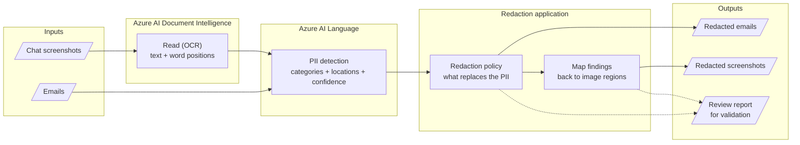

# Protecting customer data in support content with Azure AI: redacting PII from emails and screenshots

**Blog board:** Microsoft Foundry Blog / Azure AI Services
**Suggested tags:** Azure AI Services, Azure AI Document Intelligence, Azure AI Language, PII, Responsible AI, Data Privacy, Microsoft Entra ID

*How Azure AI Document Intelligence and Azure AI Language work together to find and remove personal data from the content your teams collect every day, so it can be reused safely.*

> **Disclaimer.** This is independent personal work by Vinod Patil. It is not a Microsoft product, and it is not endorsed or supported by Microsoft. The sample code mentioned in this post is a proof of concept and should not be run against real customer data.

---

## The business problem

Customer-facing teams collect unstructured content that is full of personal data: emails to a support mailbox, chat transcripts, and screenshots attached to tickets. In a card-services scenario, a customer disputing a charge will often include a card number, a national ID number, a date of birth, and a home address, in an email or read aloud in a chat that an agent then screenshots as evidence.

That content is valuable. Organizations want to use it for:

- **Quality assurance and coaching** on how fraud, dispute, and hardship conversations were handled
- **Analytics** on why customers contact support
- **Training and evaluating AI models and agents** on realistic conversations
- **Sharing with partners and vendors**, or moving it into **dev/test environments**, where production personal data should never land

The blocker is the same every time: the personal data has to be removed first, and removing it has to be reliable. Manual review does not scale and is inconsistent. Text-only tools cover emails but miss screenshots, because **an image has no text to search**.

This post describes an approach that handles both channels with managed Azure AI services.

| Channel | What the customer sends | What the business gets back |
| --- | --- | --- |
| Email | Plain text with embedded personal data | The same email with the sensitive values removed or replaced |
| Chat screenshot | An image of a conversation | The same image with sensitive regions covered |

## How Azure services solve it

Two Azure AI services each do one thing well, and the solution connects them.

| Need | Azure service | What it contributes |
| --- | --- | --- |
| Turn a screenshot into text, and know *where* each word is | [Azure AI Document Intelligence](https://learn.microsoft.com/azure/ai-services/document-intelligence/) (Read model) | Recognized text plus the position of every word on the image |
| Find personal data inside text | [Azure AI Language](https://learn.microsoft.com/azure/ai-services/language-service/personally-identifiable-information/overview) (PII detection) | Each sensitive value, its category (person, phone number, card number, and so on), its location in the text, and a confidence score |
| Secure access without secrets | [Microsoft Entra ID](https://learn.microsoft.com/entra/identity/) | Keyless, role-based access to both services |
| Explore, evaluate, and trace | [Microsoft Foundry](https://learn.microsoft.com/azure/ai-foundry/) project | Playgrounds and evaluation tooling alongside the app |

No custom model training is needed. Both services are used as managed, prebuilt capabilities.

### The key idea: connecting text findings to pixels

Azure AI Language tells you *which characters* of a text are sensitive. A screenshot has no characters, only pixels. The solution bridges the gap in three moves:

1. **Read.** Document Intelligence returns the text of the screenshot and the position of each word.
2. **Detect.** The recognized text is sent to Azure AI Language, which flags the sensitive spans.
3. **Map back and cover.** Each flagged span is matched to the words it covers, and those words' positions on the image are covered.

Emails skip the first step and go straight to detection.

### Choosing what replaces the sensitive data

What you replace the data with depends on how the content will be used. Azure AI Language's PII feature supports these redaction policies for text, and they can be set per entity category (for example, mask card numbers but replace names):

| Policy | Example result | Use when |
| --- | --- | --- |
| **Character mask** (default) | `******* called ************` | Sharing externally; strict removal |
| **Entity-label mask** | `[PERSON_1] called [PHONENUMBER_1]` | Analytics and AI training that need to know the data type |
| **Synthetic replacement** (preview) | `Sam Johnson called 401-255-6901` | Dev/test data and demos that need realistic text |
| **No mask (detect only)** | Original text plus findings | Auditing and human-review queues |

For screenshots, the equivalents are a solid box, a labeled box, or a synthetic overlay drawn over the covered region. Use an opaque fill rather than blur or pixelation, which can sometimes be partly reversed. Check the [current documentation](https://learn.microsoft.com/azure/ai-services/language-service/personally-identifiable-information/how-to/redact-text-pii) for API version and preview terms.

## The workflow, end to end

The workflow I followed has three layers. Inputs (emails and screenshots) enter on the left. Two Azure AI services do the analysis in the middle. A thin application applies the chosen policy and produces the outputs on the right. Screenshots take the longer path through OCR, and emails join at the detection step.

> **Publishing note:** Tech Community does not render Mermaid. Export this diagram as an image before posting.

### Step by step

**1. Inputs.** Emails arrive as plain text. Screenshots arrive as image files, such as JPEG or PNG. Both are processed in batches.

**2. Read the screenshot (Azure AI Document Intelligence).** The Read model performs OCR on the image. It returns the recognized text, grouped by line, and the position of every word as a shape on the image. That position data is what makes it possible to cover the right pixels later. Emails skip this step because they are already text.

**3. Detect personal data (Azure AI Language).** The text, either the email body or the text recognized from the screenshot, is sent to the PII detection feature. For each sensitive value, the service returns its category (such as person, phone number, or card number), where it sits in the text, and a confidence score. Categories can be limited to the ones you care about, and a minimum confidence can be set.

**4. Apply the redaction policy.** The service's redaction policy (see above) decides what replaces each finding in text. Findings below the confidence threshold can be dropped at this step.

**5. Map findings back to the image (application).** For screenshots, the application matches each finding's location in the text to the words that make up that text, and then to those words' positions on the image. Working word by word means a multi-word value, such as an address, is covered precisely instead of blanking the whole line.

**6. Produce outputs.** Redacted emails are written as text. Redacted screenshots are written as images with the sensitive regions covered. Originals are left untouched.

**7. Review report (optional).** The same run can capture every intermediate result: recognized text, word positions, detected entities, and final outputs, so a reviewer can check each step.

### A worked example

A customer sends a chat screenshot that contains the line "my card is 5412 7512 3412 3456". Document Intelligence returns that line as separate words, each with a position on the image. Azure AI Language receives the text of the whole conversation and flags the card number as a sensitive span, with its start location and length in the text. The application finds the four words that fall inside that span, looks up where each sits on the image, and covers just those four regions. The rest of the line, "my card is", stays readable.

### Why this design solves the business problem

- **No model to train or host.** OCR and PII detection are prebuilt, managed capabilities, so teams get to usable output without data-science effort.
- **One detection step for every channel.** Emails and screenshots share the same categories, thresholds, and policies, so results are consistent.
- **Policy is a choice, not a rebuild.** Switching from strict masking to synthetic data changes a setting, not the pipeline.
- **Separate accounts for OCR and PII detection**, so each can be sized, billed, and secured on its own.
- **Keyless by default.** API-key authentication is disabled and Microsoft Entra ID roles control access, so there are no keys to leak or rotate.
- **Repeatable deployment.** Infrastructure as code (Terraform) lets the environment be recreated, reviewed, and torn down.

I built this flow as a small proof of concept, [pii-redaction-demo](https://github.com/vinodpatil-ms/pii-redaction-demo), using synthetic emails and chat screenshots.

### Why not just ask a general-purpose LLM?

A chat model can spot personal data in a pasted paragraph, but for a control that runs on every ticket, a purpose-built service fits better:

- **Structured output.** Azure AI Language returns each entity's category, exact character offsets, and a confidence score. Those offsets enable precise masking and word-level image coverage. A generative model can vary between runs and can paraphrase or drop text it was asked to copy.
- **Built-in redaction policies.** Masks, entity labels, and synthetic replacement are service settings per category, not prompt wording to test and maintain.
- **Coordinates for screenshots.** Document Intelligence Read returns word positions. A model describing an image does not give reliable coordinates to cover.
- **Predictable cost at volume.** Prebuilt APIs are priced per unit of work, with no prompt tuning or token budgeting for long content.
- **Governance.** Customer data is processed in your own Azure subscription, under the Entra ID, networking, and logging controls you already manage.

LLMs still have a role after redaction, such as summarizing or classifying cleaned content, or acting as the agent that calls the redaction tool.

## Security and governance

- **Least privilege.** Data-plane access requires an explicit Cognitive Services User role on each account. Subscription Owner or Contributor alone does not grant it. Role assignments can take up to about 15 minutes to take effect.
- **Managed identity ready.** The same approach works for a developer running locally and for a managed identity in Azure.
- **Review output is sensitive.** A review report that shows source and result side by side contains the original, unredacted content so reviewers can validate it. In any real deployment it must be encrypted, access-controlled, retained briefly, and audited, or replaced with a redacted-only version.

## Using these services from Microsoft Foundry

Both services are part of Foundry Tools, so the same resources can be used from a Foundry project, either to explore or as the backbone of an agent.

**Explore in the portal.** The Foundry portal has a PII playground for Azure AI Language. It offers three feature types that match different inputs:

| Feature type | Input | Fits |
| --- | --- | --- |
| Text PII | Strings, synchronous | Emails, tickets, prompts, logs (used in this workflow) |
| Conversation PII | Turn-based chat or transcripts, asynchronous | Contact-center chats and call transcripts |
| Document-based PII | `.pdf`, `.docx`, `.txt` in storage, asynchronous | Redacted files that keep their layout |

The Document-based PII playground uses the same model and policies as the production API, so playground results are a fair preview of what the application will do. Screenshots are the gap: none of these feature types read pixels, which is why this workflow adds Document Intelligence Read in front of Text PII.

**Wrap the workflow as an agent tool.** If you want a Foundry agent to redact content on request, such as a support-ops agent asked to "prepare this ticket for the analytics team", expose the redaction pipeline as a tool rather than asking the model to redact text itself:

- **Function calling** for a simple, stateless `redact(content, policy)` function that runs in your own app.
- **Azure Functions** or an **OpenAPI-described API** if the redaction service is hosted and shared by several agents.
- **MCP tool** if you want the same capability reachable from other agent clients.

The agent decides when to call the tool, and the tool calls Document Intelligence and Azure AI Language. Deterministic redaction stays outside the model, and the agent only sees redacted output. Use `tool_choice` or the agent instructions to make sure content is always routed through the tool before any downstream step.

**Connect with Entra ID.** Give the agent's identity, or the managed identity that hosts the tool, the Cognitive Services User role on both accounts. That is the same keyless pattern used in this workflow.

**Trace and evaluate in Foundry.** Tracing shows each tool call, and evaluation runs against a labeled synthetic dataset can score redaction quality before the agent is allowed near real content.

Foundry agent tooling is evolving, and the classic agents experience is being replaced by the new Foundry Agent Service and its Toolbox. Check the [current documentation](https://learn.microsoft.com/azure/ai-foundry/) for the tool types available in your project.

## Where to take it next

- **Pick a redaction policy per use case.** Mask for external sharing, label for analytics, synthesize for test data and AI training.
- **Add a second line of defense.** Combine the AI service's findings with rule-based checks and mask the union.
- **Measure quality continuously.** Evaluate detection against a labeled synthetic dataset, for example with Microsoft Foundry evaluation tooling.
- **Automate the flow.** Trigger redaction when content lands in storage, run under a managed identity, and write only redacted output to downstream systems.
- **Put an agent in front of it.** Expose the workflow as a tool so a Foundry agent can request redaction as part of a larger support or analytics task.

## Conclusion

Making support content safe to reuse comes down to putting the right service on each step and keeping the connection between them explicit. Document Intelligence turns screenshots into words with positions. Azure AI Language finds the sensitive values and lets you choose what replaces them. A thin layer connects the two, Microsoft Entra ID keeps access keyless and governed, and Microsoft Foundry gives you a place to explore, trace, evaluate, and put an agent in front of it.

Start with synthetic data.

For code-level details, see the sample repository: [pii-redaction-demo](https://github.com/vinodpatil-ms/pii-redaction-demo).

## Resources

- [Redact PII from text with Azure AI Language (redaction policies)](https://learn.microsoft.com/azure/ai-services/language-service/personally-identifiable-information/how-to/redact-text-pii)
- [Azure AI Language PII detection overview](https://learn.microsoft.com/azure/ai-services/language-service/personally-identifiable-information/overview)
- [Azure AI Document Intelligence Read model](https://learn.microsoft.com/azure/ai-services/document-intelligence/prebuilt/read?view=doc-intel-4.0.0)
- [Authenticate to Azure AI services with Microsoft Entra ID](https://learn.microsoft.com/azure/ai-services/authentication)
- [Microsoft Foundry documentation](https://learn.microsoft.com/azure/ai-foundry/)
- [Tools in Foundry Agent Service](https://learn.microsoft.com/azure/ai-foundry/agents/how-to/tools/overview)
- [Sample repository: pii-redaction-demo](https://github.com/vinodpatil-ms/pii-redaction-demo)
