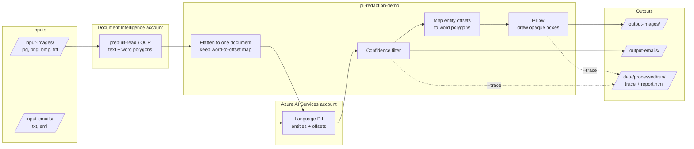
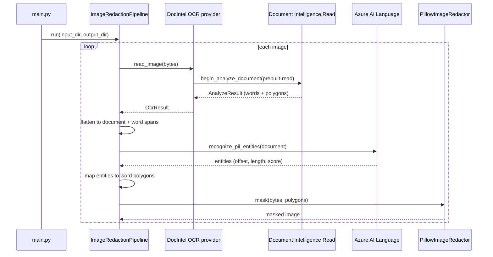

# Redacting PII from screenshots and emails with Azure Document Intelligence and Azure AI Language

**Blog board:** Microsoft Foundry Blog / Azure AI Services
**Suggested tags:** Azure AI Services, Azure AI Document Intelligence, Azure AI Language, PII, Responsible AI, Python, Terraform, Microsoft Entra ID

*Combine OCR, PII detection, and a small amount of geometry to mask sensitive data in chat screenshots and plain-text emails, with a trace report that shows what every service contributed.*

> **Disclaimer.** This is independent personal work by Vinod Patil. It is not a Microsoft product, and it is not endorsed or supported by Microsoft. The repository is a proof of concept with no error handling. Do not run it against real customer data. See [Limitations](#limitations-and-what-production-needs).

---

## The business problem

Customer-facing teams collect a lot of unstructured content that contains personal data: emails to a support mailbox, chat transcripts, and screenshots pasted into tickets. Consider a card-services team. A customer writes in about a disputed charge and, helpfully, includes a card number, an SSN, a date of birth, and a home address. The same thing happens in a chat window, where the customer reads a card number to an agent and the agent's screen is captured as evidence.

That content is valuable. Teams want to use it for:

- **Quality assurance and coaching** on how agents handled fraud and dispute calls.
- **Analytics and model training** on the reasons customers contact support.
- **Sharing with partners, vendors, or offshore teams** who do not need to see account data.
- **Lower-trust environments**, such as dev/test, where production PII should never land.

The blocker is the same each time: you have to remove the PII first. Doing this manually does not scale and is error-prone. Text-only redaction tools handle the email case, but they cannot touch a screenshot, because **an image has no text to search**. The redaction has to happen in the pixels.

This post walks through a reference implementation that handles both channels with managed Azure AI services:

| Channel | Input | Output |
| --- | --- | --- |
| Email | `.txt` / `.eml` | Same text with PII characters replaced by `*` |
| Chat screenshot | `.jpg` / `.png` / `.bmp` / `.tiff` | Same image with opaque black boxes over the PII |

The code is on GitHub: [vinodpatil-ms/pii-redaction-demo](https://github.com/vinodpatil-ms/pii-redaction-demo).

## The core challenge: text offsets versus pixels

Azure AI Language PII detection returns **character offsets** into a text document. A screenshot has none. To mask an image you need **pixel coordinates**.

The solution bridges the two worlds:

1. Use OCR to get text *and* the polygon of every recognized word.
2. Flatten the OCR output into one document while recording where each word landed (a `start`/`end` offset per word).
3. Send the flattened document to Azure AI Language.
4. Map each detected entity's offset range back to the words it overlaps, and therefore to their polygons.
5. Draw opaque boxes over those polygons.

Everything else in the project is plumbing around that idea.

## Solution overview

### Azure services used

| Service | Resource kind | Role in the solution |
| --- | --- | --- |
| [Azure AI Document Intelligence](https://learn.microsoft.com/azure/ai-services/document-intelligence/) | `FormRecognizer` | `prebuilt-read` OCR (GA API `2024-11-30`) returning text and word polygons |
| [Azure AI Language](https://learn.microsoft.com/azure/ai-services/language-service/personally-identifiable-information/overview) | `AIServices` | PII entity recognition with offsets, categories, and confidence scores |
| [Microsoft Foundry](https://learn.microsoft.com/azure/ai-foundry/) project | `AIServices` project | Portal playgrounds, evaluations, and traces |
| [Microsoft Entra ID](https://learn.microsoft.com/entra/identity/) | n/a | Keyless authentication to both data planes |

The application itself is a small Python CLI that uses Pillow for drawing. No custom model training is required.

### High-level architecture



> **Publishing note:** Tech Community does not render Mermaid. Export this diagram as an image before posting.

Key design decisions:

- **Two channels, one PII service.** Emails skip OCR and go straight to Azure AI Language. Images take the OCR detour first.
- **Separate accounts for OCR and PII.** Document Intelligence is deployed as its own account, with its own endpoint and role assignment, so each service can be sized, billed, and secured independently.
- **Entra ID only.** Both accounts are deployed with `local_auth_enabled = false`. There are no keys in configuration or code.
- **Provider/service separation.** Azure SDK calls are confined to `providers/`. The pipeline logic depends only on protocols, so it can be tested with plain stubs.

## Walkthrough of the image pipeline



### Step 1: OCR with Document Intelligence Read

The OCR provider submits the image to the `prebuilt-read` model and waits on the SDK poller. It then groups page-level words into lines by span containment, sorts the words by offset, and converts the flat polygon coordinates into integer pixel pairs.

```python
poller = self._client.begin_analyze_document(
    "prebuilt-read",
    body=io.BytesIO(image),
    content_type="application/octet-stream",
    string_index_type="unicodeCodePoint",
)
return _to_ocr_result(poller.result())
```

Two guard rails keep the masking honest. Multi-page results are rejected, because combining polygons from different pages would mask the wrong location. Coordinate units other than pixels are rejected too.

### Step 2: Flatten the document and remember where each word is

Azure AI Language needs one text document. The pipeline joins the OCR lines with newlines and records a `WordSpan` for each word: its start and end offset in the flattened text, and its image polygon.

```python
@dataclass(frozen=True, slots=True)
class WordSpan:
    start: int
    end: int
    polygon: tuple[tuple[int, int], ...]
```

### Step 3: Detect PII with Azure AI Language

`PiiRedactionService` batches documents (the service accepts at most five per request) and applies an optional confidence threshold, `APP_PII_MIN_CONFIDENCE`. The default of `0.0` masks everything the service returns, which is the safest default.

```python
responses = self._client.recognize_pii_entities(
    list(documents),
    language=language,
    categories_filter=list(categories) if categories else None,
)
```

### Step 4: Map entity offsets back to word polygons

This is the heart of the solution. For each entity, the pipeline selects every word whose span overlaps the entity's `[offset, offset + length)` range:

```python
def _polygons_for_entities(entities, spans):
    polygons = []
    for entity in entities:
        entity_end = entity.offset + entity.length
        polygons.extend(
            span.polygon
            for span in spans
            if span.polygon and span.start < entity_end and entity.offset < span.end
        )
    return polygons
```

Working at the word level means a multi-word entity such as an address or a spaced-out card number masks only the words it covers, not the whole line.

### Step 5: Draw the boxes

`PillowImageRedactor` computes a padded bounding box for each polygon, clamps it to the image, and fills it with an opaque color. The same class has an `annotate` method that draws translucent outlines. The trace report uses it to show the OCR and PII boxes before masking.

## Walkthrough of the email pipeline

Emails are simpler. The pipeline reads each file, sends the batch to Azure AI Language, and writes `redacted_text` under the original file name. Here is an excerpt of a synthetic input and the redacted output from the sample run in the repo:

**Input**

```text
My name is John Q. Public and my card number is 5412 7512 3412 3456, expiry 04/28.
...
My account number with you is 8830-114-2276 ...
Please call me on (312) 555-0184 between 9am and 5pm Central ...
My date of birth is 14/07/1981 for your records.
```

**Output**

```text
My name is ******* Public and my card number is ******************** expiry 04/28.
...
My account number with you is ************* ...
Please call me on ************** between 9am and 5pm Central ...
My date of birth is ********** for your records.
```

All sample data in the repo is synthetic and uses reserved test ranges: `555-01xx` phone numbers, `987-65-432x` SSNs, `.test` email domains, and `Example`-named streets.

## Making the pipeline explainable: the trace report

When you demo or debug a multi-service pipeline, the question is always "which service did what?" Running with `--trace` writes a timestamped folder under `data/processed/` that contains the artifacts of every step:

- The source image or email
- The normalized OCR JSON with word boxes
- The flattened document sent to Azure AI Language
- The detected entities with categories and confidence
- The masked output
- A side-by-side `report.html`, with OCR boxes and PII boxes drawn on the image

```powershell
python -m pii_redaction_demo.main --mode all --trace
```

Walking a stakeholder through `report.html` is the fastest way to show where OCR got the text right, where it missed a word, and where PII detection under- or over-reached.

> **Warning.** The trace folder is an unredacted plaintext PII store by design. It is gitignored. Delete it when you are done, and never generate it from real data.

## Deploying the infrastructure

Infrastructure is defined with Terraform, using reusable modules (`resource_group`, `cognitive_account`) and a `dev` environment root. The deployment creates:

| Resource | Kind | Purpose |
| --- | --- | --- |
| `cog-<prefix>-aiservices-<suffix>` | `AIServices` | Language PII detection and Foundry resource |
| `cog-<prefix>-docintel-<suffix>` | `FormRecognizer` | Document Intelligence `prebuilt-read` OCR |
| `<account>/<project>` | Foundry project | Playgrounds, evaluations, traces |

```powershell
cd infra/terraform/environments/dev
Copy-Item terraform.tfvars.example terraform.tfvars   # set subscription_id
terraform init
terraform plan -out=tfplan
terraform apply tfplan
```

### Identity: keyless by default

Both accounts disable API-key authentication. A single `DefaultAzureCredential` is created in the composition root and shared by both providers. Locally, `az login` is enough; in Azure, the same code works with a managed identity.

Two things catch people out:

1. **Control-plane roles are not data-plane roles.** Subscription Owner or Contributor does not grant access to the Cognitive Services data plane. Terraform assigns **Cognitive Services User** on *each* account to the configured principals.
2. **Role assignments take time to propagate**, up to about 15 minutes. A `401 PermissionDenied` right after `terraform apply` is expected. Wait and retry before you start troubleshooting.

A `smoke-test.ps1` script calls both data planes with an Entra ID token and confirms the Foundry project exists, so you can validate the deployment before running the app:

```text
LANGUAGE PII: OK
DOCUMENT INTELLIGENCE READ: OK
FOUNDRY PROJECT: OK
```

## Run it yourself

**Prerequisites:** Python 3.11+, Azure CLI (`az login`), Terraform 1.7+, and an Azure subscription where you can create resource groups and role assignments.

```powershell
python -m venv .venv
.\.venv\Scripts\Activate.ps1
python -m pip install -e ".[dev]"

# After terraform apply, copy the two endpoints into .env
#   APP_AI_SERVICES_ENDPOINT
#   APP_DOCUMENT_INTELLIGENCE_ENDPOINT
Copy-Item .env.example .env

python -m pii_redaction_demo.main --mode all --trace
```

Typical output:

```text
INFO    pii_redaction_demo.services.pipeline: redacting 5 image(s) from ...\input-images
INFO    pii_redaction_demo.services.pipeline: chat-01-fraud-dispute.jpg: 84 word(s) read, 6 entity(ies), 9 box(es) -> ...
INFO    pii_redaction_demo.main: done: 5 image(s), 5 email(s), 41 PII entity(ies) masked
```

Useful flags: `--mode {images,emails,all}`, `--trace`, `--trace-dir`, `--verbose`.

## Design lessons

**Keep SDK calls at the edge.** Adapters in `providers/` implement protocols such as `OcrProvider` and `PiiRedactionProvider`. When the project migrated its OCR from Azure Vision Image Analysis to Document Intelligence Read, only one adapter changed. The pipeline, the PII service, and the Pillow masking were untouched.

**Normalize what the service gives you.** The OCR adapter converts the Document Intelligence response into a small domain model (`OcrResult`, `TextRegion`). The trace stores that normalized result, not the raw service response, so the artifacts stay stable across SDK changes.

**Treat the model's output as input to a decision, not the decision.** The confidence threshold is a tunable trade-off. At `0.0` you favor recall and mask everything returned. Raising it toward `0.8` reduces over-masking but risks leaving real PII behind. For redaction, a miss is a data leak, so start low and measure.

**Look at the output, not just the logs.** In the sample email above, the card number, name, phone number, and date of birth were masked. But in that same run, the CVV (`921`), the card expiry, the last four SSN digits, and the full SSN were left in the clear. A pipeline that reports "41 entities masked" gives no hint of that. This is exactly why the trace report and a review of the redacted output matter, and why the next section exists.

## Limitations and what production needs

This is a proof of concept. The README lists these gaps explicitly, and each must be closed before the approach goes near real data:

| Area | Gap | What production needs |
| --- | --- | --- |
| Error handling | None: no retries, no input validation, unhandled exceptions | Backoff for 429/5xx, validation, per-item fault isolation, exit codes |
| Document limits | Azure AI Language caps a document at roughly 5,120 characters; batching is by count only | Chunk long documents and remap entity offsets to the original |
| Fault isolation | One bad file aborts the batch and no output is written | Per-item status and a quarantine path |
| Detection misses | Whatever the service returns is treated as complete | A defined failure policy, plus deterministic backstops such as regex checks for card numbers |
| Trace output | Plaintext PII by design | Redacted-only artifacts by default; encryption, access control, retention, audit if full fidelity is needed |
| Image scope | Single-page JPEG/PNG/BMP/TIFF only; Document Intelligence size limits apply | Pre-validation, multi-page and PDF support if required |
| Infrastructure | Local Terraform state, no private networking or CMK, one `dev` environment | Remote state, Private Link, customer-managed keys, diagnostics, lifecycle policy |

Also validate OCR latency and mask alignment on your own synthetic data. OCR is a submit-and-poll operation, and the app sets no overall polling deadline.

## Where to take it next

- **Add a deterministic layer** (regex and checksum validators such as Luhn for card numbers) alongside the model output, and mask the union of both.
- **Evaluate quality, not just function.** Build a labeled synthetic dataset and track precision and recall per entity category as an automated gate. [Microsoft Foundry evaluations](https://learn.microsoft.com/azure/ai-foundry/) are a natural home for that.
- **Add observability and per-item correlation IDs** so a failed or low-confidence item can be routed for human review.
- **Move to PaaS hosting** (for example, an Azure Function or Container Apps job triggered from Blob Storage) with a managed identity, and write only redacted output to the downstream store.
- **Extend input formats** to PDFs and Office documents, which Document Intelligence already supports.

## Conclusion

Redacting PII from unstructured content is a matter of putting the right service on each hop and keeping the mapping between them explicit. Document Intelligence turns pixels into words with coordinates. Azure AI Language finds the sensitive spans in the text. A small offset-to-polygon mapping connects the two, and Pillow does the last mile. Because all authentication goes through Microsoft Entra ID, there are no secrets to leak, and because every step is traceable, you can show exactly what each service contributed.

Clone the repo, deploy the dev environment, and try it on the synthetic samples. Then read the limitations list before you consider real data.

## Resources

- [pii-redaction-demo on GitHub](https://github.com/vinodpatil-ms/pii-redaction-demo)
- [Azure AI Document Intelligence Read model](https://learn.microsoft.com/azure/ai-services/document-intelligence/prebuilt/read?view=doc-intel-4.0.0)
- [Azure AI Language PII detection overview](https://learn.microsoft.com/azure/ai-services/language-service/personally-identifiable-information/overview)
- [Authenticate to Azure AI services with Microsoft Entra ID](https://learn.microsoft.com/azure/ai-services/authentication)
- [Microsoft Foundry documentation](https://learn.microsoft.com/azure/ai-foundry/)
